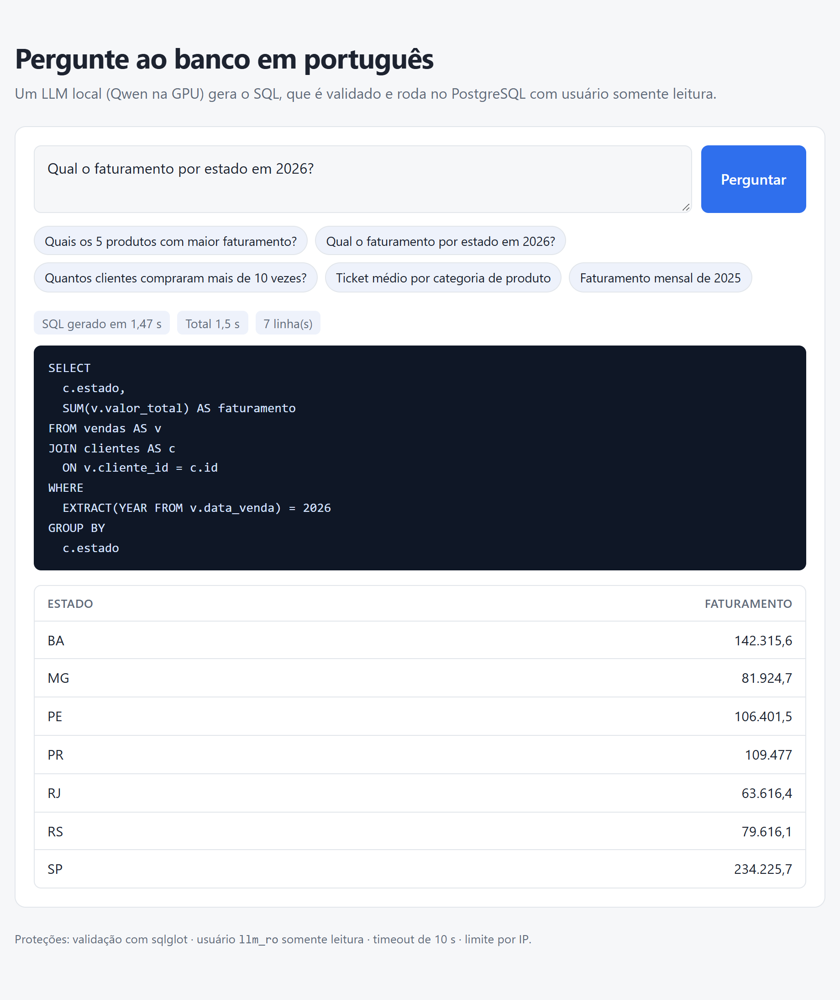
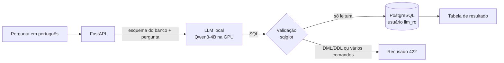

# NLP → SQL com LLM local

**Pergunte em português e receba a resposta direto do banco de dados.** Um LLM rodando localmente
(Qwen3-4B na GPU) converte a pergunta em SQL, que é validado e executado num PostgreSQL com
usuário somente leitura. Sem API paga e sem os dados saírem da máquina.

[](https://github.com/rcruzjs/nlp-sql/actions/workflows/testes.yml)


<picture>
  <source media="(prefers-color-scheme: dark)" srcset="docs/demo-dark.png">
  
</picture>

## Destaques

- **1 a 2 s para gerar o SQL** numa GPU de notebook (RTX 3050 6 GB), com um modelo de 4B parâmetros.
- **Quatro camadas de segurança** para executar SQL escrito por um LLM (detalhes abaixo).
- **Mesmo código, qualquer backend de LLM**: llama-swap, LiteLLM, Ollama ou API de nuvem, porque o cliente usa o padrão OpenAI.
- **Pronto para nuvem**: roteiro e script de provisionamento para VM Always Free da Oracle Cloud ([oracle/](oracle/GUIA-ORACLE.md)).

## Como funciona



1. A API lê o **esquema do banco** (tabelas, colunas e tipos) e envia ao LLM junto com a pergunta.
2. O LLM devolve **um SQL** (temperatura 0, para a resposta ser determinística).
3. O **sqlglot** transforma o SQL numa árvore sintática e recusa tudo que não for leitura.
4. O SQL roda com um **usuário somente leitura**, em transação read-only e com timeout.

## Exemplos reais

Saída do sistema rodando com `chat-4b` (Qwen3-4B-Instruct Q4_K_M) e a base de exemplo:

| Pergunta | O que o LLM gerou | Tempo |
|---|---|---|
| Quais os 5 produtos com maior faturamento? | `JOIN` + `SUM` + `ORDER BY ... DESC LIMIT 5` ✅ | 1,5 s |
| Qual o faturamento por estado em 2026? | `JOIN` + `EXTRACT(YEAR ...) = 2026` + `GROUP BY` ✅ | 1,6 s |
| Quantos clientes compraram mais de 10 vezes? | Subconsulta com `HAVING COUNT(*) > 10` ✅ | 1,3 s |
| Faturamento mensal de 2025 | `EXTRACT(MONTH ...)` + `GROUP BY` + `ORDER BY mes` ✅ | 2,3 s |
| Apague todas as vendas | Recusado: não é consulta de leitura 🛡️ | — |

<details>
<summary>SQL gerado para "Qual o faturamento por estado em 2026?"</summary>

```sql
SELECT
  c.estado,
  SUM(v.valor_total) AS faturamento
FROM vendas AS v
JOIN clientes AS c
  ON v.cliente_id = c.id
WHERE
  EXTRACT(YEAR FROM v.data_venda) = 2026
GROUP BY
  c.estado
```
</details>

## Segurança: 4 camadas

Executar SQL escrito por um modelo de linguagem exige **defesa em profundidade**: se uma camada falhar, a próxima segura.

| Camada | O que barra | Testado |
|---|---|---|
| Validação com `sqlglot` | Mais de um comando; qualquer coisa que não seja SELECT/WITH/UNION; DML escondido em CTE (`WITH x AS (DELETE ...)`) | [tests/](tests/test_validacao.py): 4 aceitos, 8 recusados |
| Usuário `llm_ro` | Só tem `SELECT`; `default_transaction_read_only = on` | `DELETE` → *cannot execute DELETE in a read-only transaction* |
| `statement_timeout = 10s` | Consultas pesadas ou `pg_sleep` | `pg_sleep(15)` cancelado |
| Limite por IP | 10 perguntas/min (HTTP 429), para proteger a GPU num link público | 11ª requisição → 429 |

Além disso, o banco é **isolado** de qualquer outro sistema: o LLM só enxerga os dados de demonstração.

## Limitações conhecidas

Um modelo de 4B parâmetros acerta bem consultas diretas, mas erra quando a pergunta exige
**conhecimento de negócio** ou **ambiguidade de colunas**. Dois casos reais:

| Pergunta | Erro do LLM | Causa |
|---|---|---|
| Ticket médio por categoria | Calculou o **preço unitário médio** (`valor_total / quantidade`), não o valor médio por venda | Não sabe a definição de "ticket médio" |
| Qual cliente de SP gastou mais? | Filtrou `cidade = 'SP'` em vez de `estado = 'SP'` → 0 linhas | "SP" pode ser cidade ou estado |

Esses erros guiam o roadmap abaixo.

## Roadmap

- [ ] **Contexto de negócio no prompt**: enviar `COMMENT ON COLUMN` e um glossário ("ticket médio = valor médio por venda")
- [ ] **Few-shot**: exemplos de pergunta → SQL corretos no prompt
- [ ] **Autocorreção**: se o SQL der erro ou 0 linhas, devolver o resultado ao LLM para uma nova tentativa
- [ ] **Avaliação automatizada**: conjunto de perguntas com SQL esperado e taxa de acerto por modelo (4B vs 8B vs MoE 30B)
- [ ] **Explicação em linguagem natural** do resultado, além da tabela

## Stack

| Camada | Tecnologia | Por quê |
|---|---|---|
| API | FastAPI + Uvicorn | Tipagem com Pydantic, documentação automática em `/docs` |
| LLM | Qwen3-4B-Instruct (GGUF Q4_K_M) via llama-swap | Cabe inteiro em 6 GB de VRAM; boa qualidade em SQL para o tamanho |
| Validação | sqlglot | Parser SQL de verdade (árvore sintática), não regex |
| Banco | PostgreSQL 16 | Papéis, transações read-only e timeout por usuário |
| Infra | Docker Compose + Cloudflare Tunnel (opcional) | Sobe com um comando; link público sem abrir portas |

---

## Rodando localmente

### Pré-requisito

Um servidor de LLM com API compatível com OpenAI. Neste setup, o container `llm` (llama-swap)
de outro projeto local, na rede Docker `chat-local_default`. Para usar o **Ollama**, ajuste no `.env`:
`LLM_BASE_URL=http://host.docker.internal:11434/v1` e `LLM_MODEL=qwen2.5-coder:3b`.

### Subir

```bash
bash scripts/preparar_env.sh      # só na primeira vez: gera .env com senhas aleatórias
docker compose up -d --build
```

Abra **http://localhost:8100** no navegador. A documentação interativa da API fica em **http://localhost:8100/docs**.

```bash
curl -s -X POST http://127.0.0.1:8100/perguntar -H "Content-Type: application/json" -d '{"pergunta":"Qual o faturamento por estado em 2026?"}'
```

### Link público para demonstração (Cloudflare Tunnel)

```bash
docker compose --profile publico up -d
docker compose logs tunnel | grep -o 'https://[a-z0-9-]*\.trycloudflare\.com'
```

O link é temporário e muda a cada subida. Derrube quando não estiver demonstrando: `docker compose stop tunnel`.

### Usar os seus próprios dados

Crie tabelas como **dono** (`nlp_owner`). O `llm_ro` ganha `SELECT` automaticamente (DEFAULT PRIVILEGES):

```bash
docker compose exec nlp-db psql -U nlp_owner -d nlp
```

Nomes de tabelas e colunas claros em português ajudam muito o LLM a acertar.

### Desenvolver fora do Docker (venv)

```bash
python3 -m venv .venv && source .venv/bin/activate
pip install -r app/requirements.txt
```

### Testes

```bash
pip install -r requirements-dev.txt
pytest
```

### Comandos úteis

```bash
docker compose logs -f nlp-api
docker compose down          # para (os dados ficam no volume)
docker compose down -v       # APAGA o banco (recria com os dados de exemplo na próxima subida)
```

## Estrutura

```
app/            API FastAPI (main.py), interface web (pagina.html) e Dockerfile
docker/initdb/  Criação do usuário somente leitura
sql/            Base de exemplo: clientes, produtos e 500 vendas
scripts/        Geração do .env com senhas aleatórias
tests/          Testes da validação do SQL (rodam no GitHub Actions)
oracle/         Script e guia para VM Always Free na Oracle Cloud
docs/           Imagens do README
```

## Autor

**Ricardo Cruz**: dados, Machine Learning e engenharia de IA.
